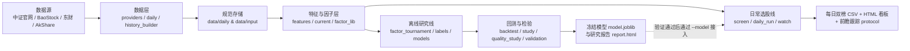

# 中证 800 量化选股与研究系统（v0.4.0）· 产品说明与程序手册

本文件夹 `csi800_quant_product/` 是整理后的**独立完整成品目录**。它彻底剥离了 2.18 GB 旧 CSV、旧 Notebook 与临时调试文件，自带**全部 30 个源码模块、44 项自动化测试、默认配置、Windows 定时任务脚本、可安装程序包（`.whl`）以及已核验的本地独立数据集**，复制到任意路径即可离线/在线运行。

---

## 一、目录结构总览

```text
csi800_quant_product/
├── 产品说明与程序手册.md               # 本文档：系统架构、每个程序的功能与运行命令
├── README.md                          # 简要安装与字段契约说明
├── run_daily_screen.py                # 统一命令行总入口（日常选股 / 建库 / 赛马 / 回测 / 体检）
├── pyproject.toml                     # Python 包配置与依赖清单（v0.4.0）
├── requirements-win-py312.lock        # Windows Python 3.12 已验证依赖版本锁文件
├── configs/
│   └── default.toml                   # 全系统参数总配置（数据门槛、因子与权重、模型、回测与费用）
├── scripts/
│   └── manage_windows_task.ps1        # Windows 计划任务一键安装 / 状态查询 / 卸载脚本
├── src/quant_screen/                  # 核心程序包（共 30 个模块，下方逐一说明）
├── tests/                             # 自动化测试套件（3 个文件，44 项测试）
├── dist/
│   └── csi800_quant_screen-0.4.0-py3-none-any.whl  # 可分发安装包
└── data/
    ├── daily/20261120-63e29c06ebf0/   # 已验收的独立日常批次（近 260 交易日行情 + 成分 + 财报）
    └── input/                         # 独立多年历史规范库（无旧 CSV 也能直接训练和回测）
        ├── quotes.parquet             # 170.4 万行 / 1,172 只历史动态股票日线（原始 + 后复权 + ST/停牌）
        ├── quality_history.csv        # 4.36 万行 / 35 个季度（2018Q1–2026Q3）东财 PIT 历史财报
        ├── membership.csv             # 1,521 条中证 800 历史动态成分与行业半开区间（覆盖 1,334 股）
        ├── calendar.csv               # 中证 800（000906）价格指数开收盘序列
        ├── csi800_total_return.csv    # 中证 800 全收益指数（H00906）收盘序列
        └── sessions.csv               # 2019–2026 A 股交易日历
```

---

## 二、系统运行流程总览



---

## 三、每一个程序用来做什么（全量逐文件说明）

### 1. 入口、配置与运维脚本（根目录 / `configs/` / `scripts/`）

| 文件 | 用来做什么 |
|---|---|
| `run_daily_screen.py` | **命令行总启动入口**。将 `src/` 加入搜索路径并调用 `quant_screen.cli.main()`，所有功能均通过它执行。 |
| `configs/default.toml` | **全局参数配置文件**。集中管理数据路径与门槛（`[data]`）、入池与打分规则（`[eligibility]`）、训练窗口与模型集合（`[research]`）、日常模型推理开关（`[screening]`）和组合持仓/费用参数（`[portfolio]`）。 |
| `scripts/manage_windows_task.ps1` | **Windows 定时任务管理脚本**。支持 `-Action install / status / uninstall`，注册工作日收盘后（默认 15:40）自动执行日常选股。 |
| `pyproject.toml` | **打包与依赖定义**。定义包名 `csi800-quant-screen`、控制台命令 `quant-screen` 及核心/研究/测试依赖组。 |

---

### 2. 核心包 `src/quant_screen/`（共 30 个 `.py` 模块）

#### A. 命令行调度、配置、工具与体检（5 个模块）

| 程序文件 | 用来做什么 |
|---|---|
| `__init__.py` | 包初始化标记文件，使 `quant_screen` 可作为标准 Python 包导入。 |
| `cli.py` | **命令总调度中心**。解析全部命令行参数（`--mode daily/all/screen/audit`、`--build-history`、`--fill-gap`、`--factor-research`、`--doctor`、`--watch`、`--replay-run`、`--import-release`、`--model`、`--standalone`、`--lockbox`），分发到对应业务模块并写入运行目录。 |
| `config.py` | **配置加载与合法性校验**。读取 `default.toml`，补齐各段默认值并校验窗口长度、权重范围、费率非负、时间窗口顺序等硬约束，防止错误配置运行。 |
| `io.py` | **底层安全读写与校验工具**。提供原子写文件（`atomic_path` 防写入中断损坏）、文件锁（`file_lock` 防多进程冲突）、SHA-256 摘要计算、股票代码 6 位标准化、日期/数值严格校验与 Parquet/CSV/JSON 读写。 |
| `doctor.py` | **系统体检模块（`--doctor`）**。一键检查 Python 依赖版本、BaoStock 是否处于 24h 退避期、日常批次与历史规范库是否就绪、报告指针是否有效，并输出具体建议命令。 |

#### B. 数据采集、日历与历史建库（7 个模块）

| 程序文件 | 用来做什么 |
|---|---|
| `providers.py` | **底层公开数据源适配器**。封装 4 类外部接口：中证官网 000906 当期成分 XLS、东财/BaoStock 指数日线、多源个股原始+后复权日线（**BaoStock 主源 + 东财 `push2his` + AkShare 备源**，内置单连接限速、EOF 超时和明确拒绝码 24 小时本地退避）、东财按季度全市场财报 `RPT_LICO_FN_CPD`（自动过滤沪深 A 股并保留原公告日）。 |
| `sessions.py` | **A 股交易日历与收盘时效判定**。判断当前北京时间处于“盘中等待收盘 / 收盘后 / 休市日”，确认应使用的最新完整交易日，并校验采集时间戳是否晚于收盘门槛（默认 15:35）。 |
| `daily.py` | **日常独立行情批次采集、校验与离线导入**。从空目录自动拉取近 260 个交易日行情、当期成分与当期财报；支持按股票断点续传、增量校对复权比例、生成带 SHA-256 的不可变批次 `data/daily/<批次>/`，以及跨机器 `--import-release` 离线导入。 |
| `history.py` | **历史基础观测与辅助采集**。负责下载独立交易日历（`sessions.csv`）、中证官网 `H00906` 全收益指数（`csi800_total_return.csv`）、BaoStock 月度历史成分抽样（`component_samples.csv`）以及补采原始日线/ST 状态。 |
| `history_builder.py` | **独立多年历史库总构建器（`--build-history` / `--fill-gap`）**。无需旧 CSV，一步式构建或更新全套 `data/input/` 规范库：交易日历、指数与全收益基准、动态历史成分与行业半开区间 `membership.csv`、多年个股日线 `quotes.parquet`、35 个季度 PIT 财报 `quality_history.csv`；同时支持 `--assemble-local` 从本机分片拼装与 `--fill-gap` 精准补采缺失日期段。 |
| `data.py` | **历史研究行情加载与拼装层**。优先支持直接从 `data/input/quotes.parquet` + `calendar.csv` 冷启动（`load_research_base`），兼容旧 CSV 白名单导入，叠加状态表/原始行情补丁，生成统一交易日历、基准收益与数据质量审计指标（`quote_audit`）。 |
| `universe_audit.py` | **历史股票池缺口审计与敏感性分析（`--audit-universe` / `--collect-universe-prices`）**。核对历史月度成分抽样的行情覆盖率、自动补采缺失成分股日线，并量化“固定股票池 vs 动态成分池”对单因子选股名单的替换影响。 |

#### C. PIT 时点对齐、因子库与特征工程（5 个模块）

| 程序文件 | 用来做什么 |
|---|---|
| `pit.py` | **历史时点（Point-in-Time）对齐引擎**。按半开区间 `[start_date, end_date)` 将 `membership.csv` 精确对齐到每个交易日（防幸存者偏差），并支持完整三表财务 `financials.csv` 按 `ann_date < date` 严格前视隔离计算 TTM 财务与估值特征。 |
| `current.py` | **当期与历史季度财务质量打分**。读取当期财报或 `quality_history.csv`，执行防雷硬过滤（正利润、正净资产、非金融股现金转化率达标），并按配置的 `value_cash_quality`（基于 PIT 市净率倒数 BP + 现金转化率 + 现金流收益率 + ROE）或 `classic_roe` 计算同行分位质量分。 |
| `features.py` | **生产与回测统一特征计算器**。计算 28 项量价/风险/微结构/流动性因子（17 项经典 + 11 项 A 股增强），并自动融合 `quality_history.csv` 导出的 4 项 PIT 估值与现金质量因子（`bp_pit`、`cfp_ttm_pit`、`ep_ttm_pit`、`cash_conversion_pit`）；计算每日截面分位（可选行业中性化）、新版低换手 A 股规则基线分（`baseline`）及 6 项市场状态指标。 |
| `factor_lib.py` | **48 因子研发候选库与行业+市值中性化引擎**。严格无前视地实现 7 大因子族共 48 个候选因子（反转/残差动量、波动与尾部风险、隔夜/日内微结构、流动性与量价、流通市值与 PIT 估值、PIT 财务质量、跨族交互），并提供 `align_pit_quality` 与跨截面行业+流通市值 OLS 残差中性化（`neutralize_cross_section`）。 |
| `factor_tournament.py` | **候选因子赛马与正交筛选模块（`--factor-research`）**。在开发期动态无偏差池上批量评估全部 48 个因子的原始与行业+市值中性化 RankIC、ICIR、HAC t 值、多空收益、覆盖率与 20 日自相关，并按相关性阈值（`|corr| ≤ 0.70`）自动筛选正交强因子、输出赛马 CSV 与 HTML 报告。 |

#### D. 交易标签、机器学习模型与统计检验（3 个模块）

| 程序文件 | 用来做什么 |
|---|---|
| `labels.py` | **可执行前瞻收益标签生成器**。按 T+1 开盘价入场、持有 N 个交易日（默认 20 日）后按开盘价退出计算相对中证 800 超额收益；开盘停牌/涨跌停无法成交的样本严格标为缺失，支持顺延退出敏感性检查。 |
| `models.py` | **滚动机器学习训练、推理与可解释性模块**。按 5 日隔离带（embargo）防止未来标签泄漏，支持 1 年半衰期指数时间衰减权重与强正则化滚动训练 `Ridge`、`LightGBM Huber`、`CatBoost`（及可选 `LGBM LambdaRank`），输出等权分位集成预测；提供 `explain()` 特征归因（TreeSHAP/线性贡献）与 `load_verified_model()` 冻结模型加载校验。 |
| `validation.py` | **量化稳健性与防过拟合检验模块**。计算横截面 RankIC、Newey-West HAC t 值、五分组超额收益、净化组合交叉验证（Purged K-Fold / CPCV 5 条路径）、样本外特征置乱重要度、Ridge 因子族消融，以及多重检验指标 DSR（Deflated Sharpe Ratio）与 PBO（Probability of Backtest Overfitting）。 |

#### E. 组合构建、模拟撮合与研究编排（5 个模块）

| 程序文件 | 用来做什么 |
|---|---|
| `market.py` | **A 股交易微观规则模块**。判定每只股票每日开盘是否停牌、涨跌停一字板、是否可买/可卖，以及主板 100 股/科创板 200 股起步的整手下单规则（`order_lot`）。 |
| `allocation.py` | **组合资产权重分配器**。实现基于 Ledoit-Wolf 收缩协方差矩阵的层次风险平价（HRP）权重算法。 |
| `backtest.py` | **逐日开盘模拟撮合回测引擎**。真实模拟 T+1 锁定、停牌顺延卖出、涨跌停阻塞、成交额参与上限、佣金/最低 5 元/过户费（含 2022-04-29 调整）/印花税（含 2023-08-28 减半）/滑点、单行业与金融合计持仓上限、调仓缓冲（`keep_rank`）；输出逐日净值、成交明细、总体绩效与分年度绩效（`yearly_performance`）。 |
| `study.py` | **开发期模型研究总编排**。串联滚动训练、全套策略回测（规则基线、各单模型、集成、双倍成本、等权/逆波/HRP 敏感性）、CPCV、DSR/PBO 与锁箱门控检查，并负责严格单次的锁箱评估（`evaluate_locked`）。 |
| `quality_study.py` | **实际发布规则的历史对照回测引擎**。利用 `quality_history.csv` 与 `membership.csv` 在同日期、同资金、同成本下回测 5 组日常策略（`quality_only`、`rules_same_pool`、`quality_mix`、`quality_mix_diversified`、`price_all`）+ 机器学习模型 + 双倍成本对照。 |

#### F. 日常选股发布、前瞻跟踪、报告与常驻监听（5 个模块）

| 程序文件 | 用来做什么 |
|---|---|
| `screen.py` | **日常候选名单打分与分散化过滤**。执行当日股票池准入门槛检查、财务质量与量价/模型融合打分、风险标记（波动过高/回撤逾 30%/ST 等）、输出原榜 Top 20、行业分散版 Top 20（单行业 ≤ 5、金融 ≤ 7）、800 只全池逐股淘汰原因表及前瞻五组对照组。 |
| `daily_run.py` | **日常选股与精确回放执行器**。协调独立日常批次的复用/增量更新、加载可选冻结模型（`--model`）、触发筛选、记录前瞻信号与结算、渲染报告及更新相对路径指针；提供 `--replay-run` 精确核验历史任意一次运行。 |
| `protocol.py` | **治理协议、报告指针、锁箱冻结与前瞻账本**。管理 `latest*.json` 相对路径指针（失败或旧数据不会覆盖最新有效报告）、`--lockbox freeze/evaluate` 防篡改冻结协议，以及前瞻信号的不可篡改登记与到期开盘收益自动结算。 |
| `report.py` | **HTML 可视化报告与净值绘图**。将日常双榜、行业分布、前瞻跟踪、五组规则历史对照、开发回测净值图、RankIC/DSR/PBO 与数据审计渲染为可直接用浏览器打开的 `report.html`。 |
| `watch.py` | **盘后常驻守护进程（`--watch`）**。按北京时间和交易日历每日收盘后自动运行，遇上游延迟每 30 分钟重试，并持续写入 `reports/watch.log` 与 `reports/watch_status.json` 心跳状态。 |

---

### 3. 自动化测试套件 `tests/`（共 3 个文件，44 项测试）

| 测试文件 | 验证内容 |
|---|---|
| `tests/test_pipeline.py` | 验证无未来函数（截断未来行情历史特征完全一致）、财报公告/重述 PIT 严格生效、历史成分半开区间、可执行标签与顺延退出、A 股撮合/滑点/冻结仓位、HRP 权重、历史财务对照与锁箱保护。 |
| `tests/test_daily.py` | 验证 BaoStock EOF/超时/拒绝码 24h 退避、空目录采集与增量/导入/损坏回退、本地缓存可移植性、前瞻五组登记与跨期结算、锁箱独立窗口与 `--watch` 调度。 |
| `tests/test_v03_framework.py` | 验证无旧 CSV 纯 `quotes.parquet` 冷启动、AkShare/东财双源日线规范化、`membership.csv` 自动构建、48 因子库与 PIT 估值零前视对齐、时间衰减权重、活跃模型解释器、金融上限回测、行业分散历史对照、相对路径指针与 `--doctor` 体检。 |

---

## 四、常用命令速查（在 `csi800_quant_product/` 目录下运行）

### 1. 安装与环境自检
```powershell
# 可选：在新机器安装已打包的成品 wheel（包含默认配置）
python -m pip install dist/csi800_quant_screen-0.4.0-py3-none-any.whl

# 系统全面体检（查看依赖、数据源退避状态、日常与历史库就绪状态）
python run_daily_screen.py --doctor

# 运行全部 44 项自动化测试
python -m pytest -q
```

### 2. 日常选股与自动托管
```powershell
# 默认日常选股：自动拉取或复用最近完整收盘批次，输出双榜 CSV + HTML 报告
python run_daily_screen.py

# 使用已验证冻结模型融合打分（需同时在 configs/default.toml 将 screening.model_weight > 0）
python run_daily_screen.py --model reports/runs/<研究批次>/model.joblib

# 常驻盘后自动运行（默认 15:35 起检测，延迟每 30 分钟重试）
python run_daily_screen.py --watch

# 注册 Windows 工作日 15:40 定时任务
powershell -ExecutionPolicy Bypass -File scripts/manage_windows_task.ps1 -Action install
```

### 3. 离线研究、因子赛马与回测（无需联网，无需旧 CSV）
```powershell
# 跑 48 因子库行业+市值中性化赛马体检
python run_daily_screen.py --factor-research --standalone

# 跑完整滚动训练 + 撮合回测 + 五组日常规则历史对照 + 分年度绩效
python run_daily_screen.py --mode all --standalone
```

### 4. 数据更新与历史补库（需要联网，支持断点续传）
```powershell
# 补齐指定日期段缺失行情（例如补 2025-06 至 2025-11 缺口；建议 BaoStock 退避结束后使用 baostock）
python run_daily_screen.py --fill-gap 2025-06-01 2025-11-10 --bar-provider baostock

# 从空目录全量构建多年独立历史库（日历、指数、成分、多年行情、35 季度东财 PIT 财报）
python run_daily_screen.py --build-history --bar-provider baostock

# 只更新东财多年 PIT 季度财报（跳过日线拉取）
python run_daily_screen.py --build-history --skip-bars
```

---

## 五、核心配置参数说明（`configs/default.toml`）

| 配置项 | 当前默认值 | 作用说明 |
|---|---|---|
| `eligibility.quality_weight` | `0.35` | 正式综合分中“财务质量分”的权重（其余 `0.65` 为量价/多因子分）；财务门槛同时作为防雷硬过滤。 |
| `eligibility.quality_profile` | `"value_cash_quality"` | 质量打分口径：`"value_cash_quality"`（基于 PIT 市净率倒数 BP + 现金转化率 + 现金流收益率 + ROE）或 `"classic_roe"`（旧版 ROE 主导）。 |
| `eligibility.baseline_profile` | `"ashare"` | 规则量价口径：`"ashare"`（A 股低波/微结构/低换手/PIT 估值校准版）或 `"classic"`（旧版美股动量口径）。 |
| `eligibility.industry_neutralize` | `false` | 是否对特征做当日行业内分位中性化。 |
| `research.active_models` | `["ridge", "lgbm_huber", "catboost"]` | 参与滚动训练与集成的活跃模型列表。 |
| `research.sample_decay_half_life` | `252` | 训练样本指数时间衰减半衰期（交易日数，0 表示等权）。 |
| `portfolio.top_k` / `keep_rank` | `20` / `60` | 目标持仓 20 只，调仓时保留仍排前 60 名的老持仓以降低换手。 |
| `portfolio.max_industry_names` / `max_financial_names` | `5` / `7` | 行业分散上限：单行业最多 5 只，金融相关行业合计最多 7 只。 |
| `portfolio.default_allocation` | `"inverse_volatility"` | 组合加权方式：`equal_weight`、`inverse_volatility` 或 `hrp`。 |
| `screening.model_path` / `model_weight` | `""` / `0.0` | 日常选股加载冻结 `model.joblib` 的路径及其在量价腿中的占比（验证通过后开启）。 |
